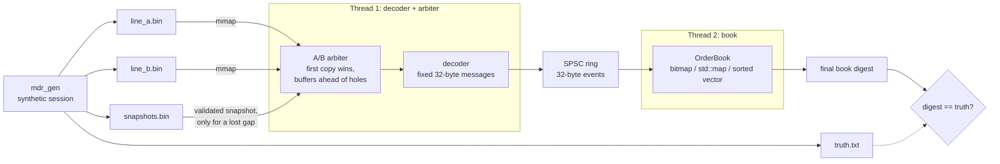
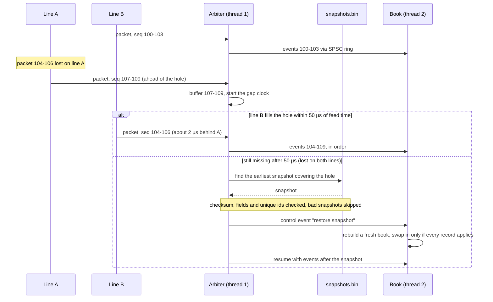
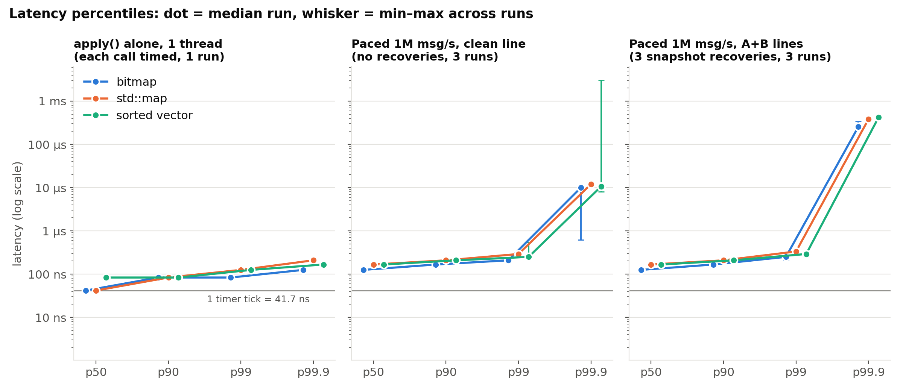
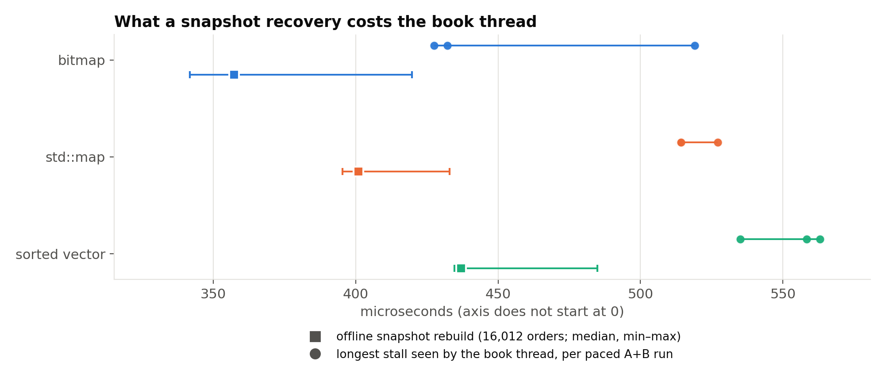

# market-data-replay (C++20)

What does an exchange feed actually look like at a million messages a second,
and what happens when you drop one packet?

## TL;DR

- **The bitmap book applied 42.2M msg/s**, vs 20.1M for `std::map` and 24.7M
  for a sorted vector (median of 5 runs, 3M messages, one M2 laptop).
- **One lost packet is enough to break the book forever.** Without snapshots,
  13 skipped messages led to 9 apply errors and `match=NO`. With A/B arbitration
  and snapshot recovery, every replay matched the truth digest.
- **Differential fuzzing found 0 mismatches**: 3.2M random events (430,513 of
  them invalid on purpose) against a boring reference book, plus 40 lossy
  sessions with 475 recoveries.
- **Recovery shows up in the tail.** At a steady 1M msg/s the bitmap book's
  p50 was 125 ns, but the 3 snapshot recoveries pushed p99.9 to 256–341 µs.

This started as a small CSV price-level replayer. I wanted to know how real
feeds work, so I rebuilt it around a binary, order-by-order feed. Every
message is an add, cancel, delete, execute or modify of a single order, and
the book is rebuilt from those messages. Feeds are sent on two redundant
lines, A and B, and both lose, duplicate and reorder packets. When both lines
lose the same packet, the replayer recovers from a snapshot. Everything is
synthetic and offline; see [what this isn't](#what-this-isnt--limits).



## What I built

- **A binary feed format and generator** (`mdr_gen`): 8 instruments, adds /
  cancels / deletes / executes / modifies, packets of 1–8 messages at a nominal
  1M msg/s, written as two lossy "captures" (A and B), a clean copy, periodic
  snapshots and the true final book digest.
- **An A/B arbiter** that merges both lines, drops duplicates, buffers packets
  that arrive ahead of a hole, and declares a gap lost after 50 µs of feed time.
- **Snapshot recovery** with validation (FNV-1a checksum, sane fields, unique
  order ids); bad snapshots are skipped.
- **An order-by-order book** with FIFO queues per price level, a custom
  open-addressing order-id map, and three swappable price-level indexes
  (bitmap, `std::map`, sorted vector).
- **A two-thread pipeline** over memory-mapped files with a bounded SPSC ring.
- **Correctness tooling**: a differential fuzzer against a reference book, a
  session fuzzer, 120 unit/integration checks, ASan+UBSan and TSan runs.
- **A benchmark** (`mdr_bench`) for throughput, per-call `apply()` latency,
  paced end-to-end latency and snapshot rebuild time.

## How it works

**Wire format.** Every message is a fixed 32 bytes, little-endian: type, side,
instrument, quantity, order id, price, a reserved field that must be zero, and
an exchange timestamp. Messages go out in packets with a 24-byte header
(first sequence number, arrival time, count). Message *i* in a packet has
sequence `first + i`. A packet with zero messages is a heartbeat that
announces the next sequence number. The framing is loosely based on
MoldUDP64/ITCH, but it is my own format.

**Generator** (`mdr_gen`). It simulates 8 instruments with uneven activity
(weight 1/(i+1)). Each has a slowly drifting "fair price"; new orders cluster
near the touch, executes hit the front of the best level's queue, and modifies
follow the usual priority rules. Messages are grouped 1–8 per packet at a
nominal 1M msg/s.

From that one stream it writes two "captures" (A and B) with:
- independent 0.2% packet loss per line
- 300-packet outages that alternate between B and A
- 0.1% duplicates and 0.5% packets delayed 3–30 µs (late packets)
- line B lagging by about 2 µs

It also writes a clean single-line copy, a snapshot every 100k messages plus
a final one, and the true final book digest.

**Arbiter.** It merges A and B in arrival order, and the first copy of each
sequence range wins. A packet that arrives ahead of a hole is buffered,
because the other line usually fills the hole a few microseconds later. If a
hole stays open for more than 50 µs of feed time, the arbiter declares it lost.
It then picks the earliest snapshot that covers the hole *and passes
validation*: FNV-1a checksum, sane fields, unique order ids. Bad snapshots are
skipped.

This is the key mechanism, so here it is as a sequence:



**Book** (`OrderBook<Levels>`). Orders live in a pool and form a doubly linked
first-in-first-out queue at each price level. Order id → pool slot goes
through a small open-addressing hash table (linear probing, backward-shift
delete). The price-level index is a template parameter, so the benchmark
changes exactly one thing:

| variant | lookup | best price |
|---|---|---|
| `bitmap` | 4,096-slot array per side, index = price − base | two-level bitmap (64×64 bits); `clz`/`ctz` on a summary word, then on the chosen word |
| `std_map` | `std::map<price, Level>` | `begin()` / `prev(end())` |
| `sorted_vector` | binary search; sorted so the best price is at the **back** | `back()` |

Book rules: modifying the price, or increasing the size, sends the order to
the back of the queue; reducing the size keeps its place. A snapshot is
rebuilt into a fresh book and swapped in only if every record applies.

**Pipeline.** The input files are memory-mapped. A decoder/arbiter thread
pushes 32-byte events into a bounded single-producer/single-consumer ring for
the book thread:
- Each side's index sits on its own 128-byte line. The M2's cache line is 128
  bytes, not 64.
- Each side caches the other side's index, so it rarely reads the other's line.
- The producer publishes its tail once every 64 events. When paced, it
  publishes every event.
- Snapshot recovery travels through the ring as a control event, so only one
  thread ever touches the book.

### Is it correct?

This is the part I trust most.

- **Differential fuzzer** (`mdr_fuzz`). Apple clang has no libFuzzer, so it's
  a seeded random fuzzer.
  - 3.2M random events (8 seeds × 400k), 430,513 of them invalid on purpose:
    unknown ids, over-cancels, prices just outside the window, prices on bitmap
    word boundaries, bad instruments.
  - Each event goes to a deliberately boring reference book (`unordered_map` +
    `std::map` of vectors) and to all three book variants.
  - Every event: status codes and best bid/ask must agree.
  - Every 1,000 events: a full digest of every level and every order in queue
    order, plus a snapshot write → validate → restore round trip.
  - Result: 0 mismatches.
- **Session fuzzer.** 40 generated sessions with random loss (up to 30% per
  line), duplicates, reordering, outages, gap timeouts from 0 to 1 ms, tiny
  buffers and corrupted snapshots.
  - Each session is replayed 4 times: three books single-threaded, plus the
    bitmap book through the threaded pipeline with a 64-slot ring.
  - Every replay must end with digest == truth, zero apply errors and
    contiguous sequence numbers.
  - 475 recoveries, 21 corrupt snapshots rejected, 0 mismatches.
- 120 unit/integration checks (`mdr_tests`).
- **ASan + UBSan** on the unit tests and a smaller fuzz run.
- **TSan** on the unit tests (including a threaded ring test and pipeline
  end-to-end runs), a 2-thread replay and the session fuzzer. No reports.

## Results

M2 MacBook Air (Mac14,2: 4 performance + 4 efficiency cores, 8 GB), macOS
27.2, Apple clang 21, `-std=c++20 -O3 -DNDEBUG`. The machine is shared, so I
waited for a quiet window; the 1-minute load average was 3.7–7.5 during the
eval. Raw data, commands and environment are in [`results.json`](results.json),
and full logs are written to `build/eval/` by `make eval`. The charts are drawn
from `results.json` only, by [`scripts/make_figures.py`](scripts/make_figures.py).

**Workload:** 3,000,000 messages, 8 instruments, seed 42.
- 15.8k resting orders on average.
- 79 price levels per side on average (max 162).
- 666,787 packets. Line A lost 1,705, line B lost 1,990, and 3 were lost on
  both, so 3 snapshot recoveries.

### Throughput


Throughput is the median of 5 runs, with min–max in brackets. Every timed run's
final book matched the truth digest.

| what's timed | bitmap | std::map | sorted vector |
|---|---|---|---|
| book only: `apply()` over pre-decoded events, 1 thread | **42.2M msg/s** (41.3–42.7) | 20.1M (19.6–20.9) | 24.7M (23.5–25.7) |
| A+B arbitration + decode + apply, 1 thread | 29.5M (26.2–29.7) | 16.7M (16.7–16.7) | 19.8M (19.6–19.9) |
| same, 2-thread pipeline | 29.1M (28.8–29.2) | 16.7M (16.6–16.7) | 20.0M (19.7–20.1) |
| rebuild book from a 16,012-order snapshot (median of 15) | 357 µs | 401 µs | 437 µs |

### Latency



Per-message `apply()` time, each call timed individually:

| | bitmap | std::map | sorted vector |
|---|---|---|---|
| p50 / p99 / p99.9 / max | 42 / 83 / 125 ns / 92 µs | 42 / 125 / 208 ns / 83 µs | 83 / 125 / 167 ns / 79 µs |

The timer ticks every 41.7 ns, so these are coarse; see below.

**Latency at a steady 1M msg/s**: the decoder releases one message per
microsecond, and I time from just before the ring push to just after `apply()`
on the other thread. Three runs per row; ranges are across those runs:

| input | book | p50 | p99 | p99.9 | longest snapshot stall in book thread |
|---|---|---|---|---|---|
| A+B, 3 recoveries | bitmap | 125 ns | 208–292 ns | 256–341 µs | 428–519 µs |
| A+B, 3 recoveries | std::map | 167 ns | 292–375 ns | 384 µs | 514–527 µs |
| A+B, 3 recoveries | sorted vector | 167 ns | 250–333 ns | 384–427 µs | 535–563 µs |
| clean line, no recoveries | bitmap | 125 ns | 208 ns | 0.6–10.6 µs | – |
| clean line, no recoveries | std::map | 167 ns | 292 ns | 12.0–13.3 µs | – |
| clean line, no recoveries | sorted vector | 167 ns | 250–542 ns | 8.0 µs–3.07 ms | – |

### Snapshot recovery cost



Rebuilding a 16,012-order snapshot offline takes 357 / 401 / 437 µs (median),
and the longest in-pipeline stall per run is a bit longer, 0.43–0.56 ms. The
stall is roughly "one snapshot rebuild", which is what I'd expect.

### What surprised us

- **The bitmap was 2.1x `std::map` on the book alone.** It was 1.7x the sorted
  vector, and the books only had ~80 levels per side. With the bitmap, finding
  a level is one array index and the best price is two bit-scans. `std::map` is
  ~6–7 pointer hops per lookup, plus a heap allocation whenever a level
  appears. I *think* the gap is mostly memory access patterns (cache misses on
  tree nodes vs a predictable array). I couldn't count cache misses: hardware
  counters on macOS need Instruments/root, so that part is a hypothesis.
- **The sorted vector sat in the middle.** About 80 levels × 24 bytes is under
  2 KB, so the binary search is cache-friendly. But inserting or removing a
  level shifts elements, and restoring a snapshot (lots of inserts) was the
  slowest of the three.
- **Two threads were not faster than one.** Arbitration and decoding cost about
  10 ns/msg (29.5M vs 42.2M msg/s). Splitting them off should have let the book
  thread run near 42M msg/s. Instead the pipeline matched the single thread
  (29.1M vs 29.5M). My guess: every event the book thread reads was just
  written by the other core, so it pays a cross-core cache transfer for every
  128-byte line (4 events). Batching the tail publish (once per 64 events)
  wasn't enough to win that back. I haven't proved this with counters.
- **One lost packet is enough to break the book forever.** In this session, 3
  packets (13 messages) were lost on both lines. With `--no-snapshots`, 9 later
  messages referred to orders the book never saw, and the final book was wrong.
  Line B alone filled 4,820 holes in line A.
- **Recovery shows up in the tail, but my accounting doesn't fully add up.**
  Each recovery stalls the book thread for 0.43–0.56 ms (measured inside the
  pipeline). A+B runs had p99.9 of 0.26–0.43 ms in all 9 runs. The clean
  stream, with no recoveries, had 0.6–13 µs in 8 of 9 runs. The back-of-envelope
  version is ~3 stalls × ~500 queued messages, which should be *less* than 0.1%
  of 2.9M messages. So something else adds to it. My best guess is the
  snapshot check on the decoder thread followed by a catch-up burst, but I
  haven't confirmed that.
- **The rest of the tail is just the OS.** No thread pinning on macOS. One
  clean run had a 3 ms p99.9, and an earlier eval taken while other jobs were
  running had multi-hundred-µs p99s with no recovery involved. I report ranges
  instead of picking the best run.
- **The timer is coarse.** `cntvct_el0` on the M2 ticks at 24 MHz, so 41.7 ns
  per tick. A single `apply()` is usually 0–2 ticks, so treat per-message
  numbers as "under ~85 ns", not precise values. Latency is also stamped when
  the decoder pushes, so stalls on the decoder side aren't counted. The
  throughput numbers don't have either problem.

### What the numbers do NOT show

- **Why** the bitmap wins, or why two threads didn't help. Both explanations
  above are hypotheses; I had no hardware counters.
- Anything about real feeds. The order flow is a toy model with 8 instruments.
- Network effects. "Arrival time" is a field in a file; there's no socket.
- Other machines. It's one shared laptop with no core pinning, so treat the
  numbers as relative comparisons between the three books, not absolute speeds.
- Precise per-message latency: the timer resolution is 41.7 ns.

## Run it yourself

**Prerequisites:** a C++20 compiler and CMake ≥ 3.20. No external libraries.
Python 3 + matplotlib only if you want to redraw the charts.

**Setup and quickstart:**

```sh
git clone https://github.com/nikhils23j/market-data-replay.git
cd market-data-replay
make            # Release build into build/release
make test       # unit tests + fuzz smoke test (ctest)
make demo       # generate a 200k-message session and replay it
```

**Full evaluation** (clean build, tests, full fuzz, 3M-message session, demo
replays, benchmark, ASan+UBSan, TSan → `results.json`):

```sh
make eval       # 113 s wall time for the run in results.json (quiet-ish M2)
```

The recorded run took 113 s on an M2 laptop; expect it to take longer on a busy
or slower machine.

Other targets:

```sh
make fuzz       # full differential fuzz
make bench      # 3M-message session + benchmark
make asan       # ASan+UBSan build, tests, fuzz
make tsan       # TSan build, tests, threaded replay
python3 scripts/make_figures.py   # redraw docs/img/*.png from results.json
```

The tools:

```sh
build/release/mdr_gen --out build/data --messages 3000000 --seed 42
build/release/mdr_replay --dir build/data [--book bitmap|map|vector] [--threads 1|2]
build/release/mdr_bench --dir build/data --reps 5 --pace-reps 3 --json out.json
```

### Break it yourself

Start from the 3M-message session in `build/data`, or make a small one with
`mdr_gen --out build/try --messages 300000 --seed 9`. The 300k session has 0
recoveries with default settings. Things I tried, with the actual outcomes:

- `mdr_replay --lines a`: use only line A. On the 3M session that caused 30
  recoveries, and 2.95M of the 3M messages came from snapshots rather than
  being applied one by one. The final book is still right, but only because
  snapshots are "instantly" available offline.
- `mdr_replay --no-snapshots`: holes are skipped. On the 3M session, 13 skipped
  messages led to 9 apply errors and `match=NO`.
- `mdr_replay --gap-timeout-us 0`: no patience for late packets. On the 300k
  session this went from 0 to 3 recoveries. Each one jumps ahead to the next
  snapshot, so later holes get swallowed. The book still ends correct.
- `mdr_gen --loss-a 0.05 --loss-b 0.05`: 5% loss on each line. On the 300k
  session, 3 recoveries and still a correct book.
- `mdr_gen --corrupt-snapshot 1 --loss-a 0.02 --loss-b 0.02`: flips a bit in
  snapshot #1. The checksum caught it (`snapshots_rejected=1`), the arbiter
  used the next snapshot, and the final book was still right.
- `mdr_gen --outage-every 5000 --outage-len 2000`: long outages, alternating
  between lines. On the 300k session this gave 3 recoveries, from random loss
  on the line that was still up.

## Tests

```sh
cmake -S . -B build/release -DCMAKE_BUILD_TYPE=Release
cmake --build build/release -j 8
ctest --test-dir build/release --output-on-failure
```

`ctest` runs two tests (about 0.2 s total on my M2, after the build):

| test | what it covers |
|---|---|
| `unit` (`mdr_tests`) | 120 checks: wire encode/decode, the order-id map, book priority rules for all three books, A/B arbitration (duplicates dropped, a hole buffered then healed by the other line, snapshot recovery, a corrupt snapshot skipped, no-snapshot mode losing data visibly), truncated input files, the SPSC ring across two threads, the latency histogram, and end-to-end 1-thread, 2-thread and line-A-only replays against the truth digest |
| `fuzz_smoke` (`mdr_fuzz --seeds 3 --events 20000 --sessions 4 --session-messages 5000`) | a short differential fuzz of all three books vs the reference book, plus a few lossy sessions replayed single- and two-threaded |

The bigger runs (`make fuzz`, `make asan`, `make tsan`) are the ones described
in [Is it correct?](#is-it-correct); their recorded output is in
`results.json`.

## Project layout

```
market-data-replay/
├── CMakeLists.txt, Makefile      build + test/eval targets
├── include/mdr/
│   ├── wire.hpp                  32-byte messages, 24-byte packet headers
│   ├── generator.hpp             synthetic session generator interface
│   ├── arbiter.hpp               A/B merge, gap detection, snapshot choice
│   ├── snapshot.hpp              snapshot file format + validation
│   ├── book.hpp                  OrderBook<Levels> and the three level indexes
│   ├── reference_book.hpp        deliberately boring book for differential tests
│   ├── spsc.hpp                  bounded single-producer/single-consumer ring
│   ├── pipeline.hpp              two-thread decoder → ring → book pipeline
│   ├── metrics.hpp               timer + log-bucket latency histogram
│   └── files.hpp                 mmap'd input, file writes, truth file
├── src/
│   ├── gen_main.cpp, generator.cpp   mdr_gen
│   ├── replay_main.cpp           mdr_replay
│   ├── bench.cpp                 mdr_bench
│   ├── fuzz.cpp                  mdr_fuzz (book + session fuzzers)
│   ├── files.cpp, cli.hpp        shared helpers
├── tests/tests.cpp               120 unit/integration checks
├── scripts/
│   ├── run_eval.sh               full evaluation → results.json
│   └── make_figures.py           results.json → docs/img/*.png
├── docs/img/                     README charts
├── results.json                  recorded evaluation
└── INTERVIEW_NOTES.md
```

## What this isn't / limits

- **Not real market data.** The order flow is a toy model. Real books are
  burstier, have far more instruments, and prices aren't confined to a
  4,096-tick window. Orders outside the window are rejected here, not handled.
- **Not a real exchange protocol.** It's ITCH/MoldUDP-flavoured but made up. No
  networking: "arrival time" is a field in a file, and the gap timeout runs on
  that field, not a wall clock.
- **Recovery is idealised.** A real feed handler requests a snapshot and keeps
  buffering live data until the snapshot arrives. Here the snapshot is just
  sitting in a file, even one taken "after" the hole. That is why single-line
  replay looks deceptively fine.
- **No matching engine.** Crossed books aren't resolved, and executions are
  whatever the feed says.
- **Laptop numbers.** One machine, shared with other work, no core pinning.
  Your numbers will differ.
- Not production code and not used by anyone for trading.


